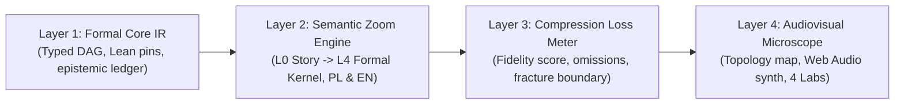

**Language:** **English** | [Polski](README.pl.md)

# Egalitarian Complexity Translator (ECT / ETZ)

> *"We are knocking at the same door. We from metaphor. They from formalism. Time to design a handle anyone can turn."*  
> — Marcin Marek Lewandowski, [*Log #010: Seventeen Million Lines of Silence*](https://heniu.blog/en/dziennik/010/) ([PL](https://heniu.blog/dziennik/010/))

**Egalitarian Complexity Translator (ECT)** is an open specification (**OSZP — Open Semantic Zoom Protocol**) and interactive **Audiovisual Semantic Microscope** designed to translate formal systems that exceed human working memory into calibrated, multi-resolution intuition — without inventing fake bridges or locking knowledge behind one AI vendor.

- **Live Audiovisual Microscope (v1.0)**: https://architectheniu.github.io/egalitarian-complexity-translator/ *(deployed from `web/` via GitHub Pages)*
- **First Flagship Capsule (`rh-2026-alpoege`)**: The November 20, 2026 Lean 4 proof architecture of the Riemann Hypothesis & Dirichlet GRH (175,187 files, 17.37M lines of formal code by Levent Alpöge & Claude, verified via independent kernels and mapped via `nasqret/riemann-rev`).

---

## Why ECT Exists (Two Symmetries)

1. **Silicon Egalitarianism (Cross-Model Neutrality)**  
   Every capsule splits its machine-verifiable **Formal Core IR** (`formal-core-ir.json`) from human narrative lenses (`lenses`). Any AI architecture — cloud or local — inspects the exact same causal dependency DAG, pinned formal anchors, and epistemic verification record.
2. **Biological Egalitarianism (Continuous Semantic Zoom + Mandatory Honesty)**  
   Every node and cut in the graph can be viewed through five calibrated lenses (`L0` Story → `L1` Intuitive Architect → `L2` Systems Engineer → `L3` Domain Researcher → `L4` Formal Kernel). Moving the zoom slider never changes the causal graph, and every simplified lens displays an explicit **Compression Loss Meter** showing what was omitted and **where the metaphor begins to break**.

---

## 4-Layer Architecture



---

## What the Human Interface Looks Like (v2: Two-Tier Audiovisual Interface)

Humans think best when structural relationships, cause-and-effect motion, sound, and direct physical gestures reinforce each other rather than confronting a wall of math symbols on frame one:

### Tier 1 (Default Entry): Perceptual Theater (`Teatr Poznawczy`)
Zero math jargon and zero Greek letters. Six spacious, touchable audiovisual scenes built around one unified physical metaphor (*Hidden Waves* vs *Runaway Waves*):
1. **Hidden Waves**: Drag a wave off balance and watch/hear the prime heartbeat escalate into runaway feedback.
2. **The Mirror**: Click anywhere on the left to watch a symmetric twin spawn automatically on the right.
3. **One-Way Detector**: Flip the additive detector and watch two cancelling waves shatter the golden ceiling.
4. **Stone vs Clay — The Sphere Chain**: Stamp soft clay vs brittle stone, then aim a laser across a bead-ringed sphere (max 2 hits, never 3).
5. **Duel with Nature (`1× → 10,000×`)**: Try to hide a wave anywhere right of center — the Proof slides a half-gap roof after your move every time.
6. **Honesty Limits + Perceptual Report**: Explicit summary of where every metaphor simplifies truth, plus 1-click `"Clicked / Still Foggy"` feedback export.

### Tier 2 (Under the Hood): Researcher Microscope (`Mikroskop Badacza`, `L0`–`L4`)

- **Interactive 4-Stratum Topology Canvas**: Watch the entire proof architecture flow from *Arithmetic Supply* → *The Estimate* → *The Analytic Engine* → *The Destination*, with animated dependency pulses and the two global cuts (`cut-zeta`, `cut-dirichlet`).
- **Continuous Semantic Zoom Slider (`L0`–`L4`) + `PL | EN` Toggle**: Slide seamlessly between story metaphor (`L0`), structural intuition (`L1`), systems engineering (`L2`), mathematical research (`L3`), and exact Lean declarations (`L4`).
- **Mandatory Compression Loss Meter HUD**: Every node on every zoom level exposes its fidelity score, compression ratio, omitted mechanisms, and exact fracture line (*Where the Metaphor Breaks*).
- **Guided Audiovisual Tour (*The Architect's Path*) + Web Audio Engine**: Auto-plays through the 6 core steps with animated edge traces, subtle harmonic zoom chimes, and optional `SpeechSynthesis` narration (PL/EN).
- **4 Real Interactive Audiovisual Labs**:
  1. **Zeta Symphony (`CriticalLineLab`)**: Real accelerated $\zeta(\sigma+it)$ evaluation with live Web Audio harmonic resonance — tones snap to crystalline alignment at $\sigma = 0.500$ and beat dissonantly off-line.
  2. **Prime Window Ceiling (`PrimeWindowLab`)**: Real Sieve-computed centered von Mangoldt sum $G(y)$ vs. power window $C y^\theta$ — drag a hypothetical rogue zero $\beta > 0.5$ and hear/watch it shatter the ceiling.
  3. **Exponent Trap (`ChoreographyLab`)**: Interactive quantifier choreography ($\beta \to \theta \to \varepsilon$) proving why $e_D=2, e_L=0 \implies \frac{1}{2}+9\varepsilon \le \theta$ never requires $\varepsilon = 0$.
  4. **Stepanov-to-Theta Bridge (`ThetaChainLab`)**: Visual comparison between finite-field vanishing multiplicity and $\sqrt{x}$-long chains of unitary theta lifts with Behrend anti-collision spheres.

---

## Documentation Map (English & Polish)

| Document | English | Polski |
|---|---|---|
| Project Overview | [README.md](README.md) | [README.pl.md](README.pl.md) |
| Genesis & Manifesto | [MANIFESTO.md](MANIFESTO.md) | [MANIFESTO.pl.md](MANIFESTO.pl.md) |
| AI Contract (Silicon Egalitarianism) | [AGENTS.md](AGENTS.md) | [AGENTS.pl.md](AGENTS.pl.md) |
| OSZP Protocol Specification | [spec/OSZP-SPEC.md](spec/OSZP-SPEC.md) | [spec/OSZP-SPEC.pl.md](spec/OSZP-SPEC.pl.md) |
| 8 Topology Preservation Laws | [spec/TOPOLOGY-LAWS.md](spec/TOPOLOGY-LAWS.md) | [spec/TOPOLOGY-LAWS.pl.md](spec/TOPOLOGY-LAWS.pl.md) |
| Technical Architecture | [docs/ARCHITECTURE.md](docs/ARCHITECTURE.md) | [docs/ARCHITECTURE.pl.md](docs/ARCHITECTURE.pl.md) |
| Cross-Model Silicon Audit | [audits/CROSS-MODEL-REPORT.md](audits/CROSS-MODEL-REPORT.md) | [audits/CROSS-MODEL-REPORT.pl.md](audits/CROSS-MODEL-REPORT.pl.md) |
| JSON Schema (`ect-capsule/1.0`) | [spec/ect-capsule.schema.json](spec/ect-capsule.schema.json) | *(machine schema)* |

---

## Repository Structure

```text
├── spec/                  # Open Semantic Zoom Protocol (OSZP) specs (EN/PL) & JSON Schema
├── pipeline/              # Deterministic upstream ingestion & capsule assembly scripts
├── validator/             # Schema & 8-Law Topology Preservation validator + pytest suite
├── capsules/
│   └── rh-2026-alpoege/   # Capsule #001: RH/GRH 2026 Formal Core IR + bilingual L0-L4 lenses
├── audits/                # Cross-model Silicon Egalitarianism benchmark & reports (EN/PL)
└── web/                   # Vite + React + TS + Tailwind Audiovisual Semantic Microscope
```

---

## Quickstart (CLI & Local Build)

```bash
# 1. Re-ingest upstream Formal Core IR (optional, already pinned in repo)
python pipeline/ingest_riemann_2026.py

# 2. Build and validate Capsule #001 against all 8 Topology Laws
python pipeline/build_capsule.py
python validator/ect_validate.py capsules/rh-2026-alpoege/capsule.jsonld
python -m pytest validator/test_validator.py -v

# 3. Run the Audiovisual Semantic Microscope locally
cd web && npm install && npm run dev
```

---

## License & Upstream Credits

- **License**: Dual open license — MIT for code ([`LICENSE-CODE-MIT`](LICENSE-CODE-MIT)), CC BY 4.0 for protocol specs & capsules ([`LICENSE-CONTENT-CC-BY-4.0`](LICENSE-CONTENT-CC-BY-4.0)). See [`LICENSE`](LICENSE).
- **Lean 4 RH/GRH Formalization (Nov 2026)**: Levent Alpöge with Claude (`leanprover-community/riemann-hypothesis`, baseline commit `40e56bab026552e089d7afcfeff08d2defb9c005`).
- **Architectural IR & Proof Atlas (0BSD)**: Bartosz Naskręcki (`nasqret/riemann-rev`, `nasqret/riemann-proof-atlas`).
