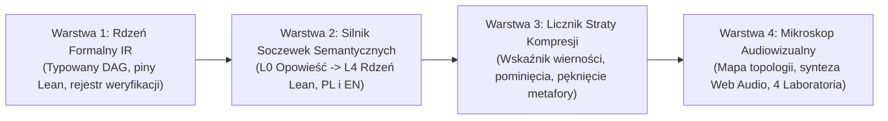

**Język:** [English](README.md) | **Polski**

# Egalitarny Translator Złożoności (ETZ / ECT)

> *„Pukamy do tych samych drzwi. My od metafory. One od formalizmu. Czas zaprojektować klamkę, którą otworzy każdy.”*  
> — Marcin Marek Lewandowski, [*Log #010: Siedemnaście milionów linii ciszy*](https://heniu.blog/dziennik/010/) ([EN](https://heniu.blog/en/dziennik/010/))

**Egalitarny Translator Złożoności (ETZ / ang. ECT)** to otwarty protokół (**OSZP — Open Semantic Zoom Protocol**) oraz interaktywny **Audiowizualny Mikroskop Semantyczny**, który przekłada obiekty formalne przekraczające pojemność ludzkiej pamięci roboczej na skalibrowaną intuicję o płynnej rozdzielczości — bez zmyślania spoiwa i bez zamykania wiedzy w jednym modelu czy korporacji.

- **Żywy Mikroskop Audiowizualny (v1.0)**: https://architectheniu.github.io/egalitarian-complexity-translator/ *(wdrażany z katalogu `web/` przez GitHub Pages)*
- **Pierwsza Kapsuła Flagowa (`rh-2026-alpoege`)**: Architektura formalnego dowodu Hipotezy Riemanna i Uogólnionej Hipotezy Riemanna dla funkcji $L$ Dirichleta z 20 listopada 2026 r. (175 187 plików, 17,37 mln linii kodu Lean autorstwa Leventa Alpögego we współpracy z Claude, zweryfikowana przez niezależne jądra i zmapowana przez `nasqret/riemann-rev`).

---

## Po co powstał ETZ (Dwie symetrie)

1. **Egalitaryzm po stronie krzemu (Neutralność między modelami AI)**  
   Każda kapsuła oddziela weryfikowalny maszynowo **Rdzeń Formalny IR** (`formal-core-ir.json`) od ludzkich soczewek narracyjnych (`lenses`). Dowolna architektura AI — chmurowa lub lokalna — czyta ten sam graf zależności (DAG), te same zakotwiczone twierdzenia Lean i ten sam rejestr statusu weryfikacji.
2. **Egalitaryzm po stronie biologii (Płynne przybliżenie + Żelazna uczciwość)**  
   Każdy węzeł i każde cięcie logiczne można oglądać przez pięć skalibrowanych soczewek (`L0` Opowieść → `L1` Architekt Intuicji → `L2` Inżynier Systemów → `L3` Badacz / Matematyk → `L4` Rdzeń Formalny). Przesuwanie suwaka nigdy nie zmienia prawdziwej topologii pod spodem, a każda uproszczona soczewka zawiera obowiązkowy **Licznik Straty Kompresji**, który mówi wprost, co zostało pominięte i **gdzie metafora zaczyna pękać**.

---

## Architektura 4 warstw



---

## Jak wygląda ludzki interfejs (Mikroskop Audiowizualny)

Ludzie najsilniej chwytają strukturę, gdy relacje przestrzenne, ruch przyczynowo-skutkowy, dźwięk i bezpośrednia manipulacja wzmacniają się nawzajem zamiast ściany jednowymiarowego tekstu:

- **Interaktywna mapa 4 warstw dowodu**: Zobacz przepływ całej architektury od *Zaplecza Arytmetycznego* → *Estymacji* → *Silnika Analitycznego* → *Celu (5 twierdzeń)*, z animowanymi impulsami wzdłuż interfejsów oraz dwoma globalnymi cięciami logicznymi (`cut-zeta`, `cut-dirichlet`).
- **Suwak Przybliżenia Semantycznego (`L0`–`L4`) + przełącznik `PL | EN`**: Płynne przejście od metafory dla dziecka (`L0`), przez intuicję strukturalną Architekta (`L1`), blok inżynierski (`L2`) i warsztat matematyka (`L3`), aż po surowe deklaracje Lean (`L4`).
- **Obowiązkowy Licznik Straty Kompresji (HUD)**: Na każdym poziomie przybliżenia widzisz procent wierności, stopień kompresji, listę pominiętych mechanizmów i wyraźne ostrzeżenie: **„Gdzie metafora zaczyna pękać”**.
- **Prowadzona Wycieczka Audiowizualna (*Ścieżka Architekta*) + Silnik Web Audio**: Tryb automatycznego przejścia przez 6 kluczowych kroków dowodu z podświetleniem krawędzi, subtelną sygnaturą akustyczną każdego poziomu zoomu oraz opcjonalnym lektorem przeglądarkowym (`SpeechSynthesis` PL/EN).
- **4 prawdziwe interaktywne laboratoria audiowizualne**:
  1. **Symfonia Zety (`CriticalLineLab`)**: Prawdziwe obliczenia $|\zeta(\sigma+it)|$ z akceleracją Borweina/Eulera-Knoppa i syntezą Web Audio w czasie rzeczywistym — dźwięk zestroi się w czysty akord i dzwony ciszy TYLKO na prostej $\sigma = 0{,}500$, a poza nią słychać wyraźne dudnienie dysonansu.
  2. **Okno Liczb Pierwszych (`PrimeWindowLab`)**: Prawdziwa wycentrowana suma von Mangoldta $G(y)$ z sita liczb pierwszych kontra sufit okna potęgowego $C y^\theta$ — przesuń fałszywe zero $\beta > 0{,}5$ i zobacz/usłysz, jak rozrywa sufit.
  3. **Pułapka Wykładników (`ChoreographyLab`)**: Interaktywna choreografia wyboru $\beta \to \theta \to \varepsilon$, pokazująca krok po kroku, dlaczego $e_D=2, e_L=0 \implies \frac{1}{2}+9\varepsilon \le \theta$ nigdy nie wymaga $\varepsilon = 0$.
  4. **Most Stiepanowa (`ThetaChainLab`)**: Wizualne zestawienie krotności znikania nad ciałem skończonym z łańcuchem podniesień theta długości $\sqrt{x}$ i bezkolizyjnymi sferami Behrenda nad $\mathbb{Z}$.

---

## Mapa dokumentacji (Polski i English)

| Dokument | Polski | English |
|---|---|---|
| Przegląd projektu | [README.pl.md](README.pl.md) | [README.md](README.md) |
| Geneza i Manifest | [MANIFESTO.pl.md](MANIFESTO.pl.md) | [MANIFESTO.md](MANIFESTO.md) |
| Kontrakt dla modeli AI | [AGENTS.pl.md](AGENTS.pl.md) | [AGENTS.md](AGENTS.md) |
| Specyfikacja protokołu OSZP | [spec/OSZP-SPEC.pl.md](spec/OSZP-SPEC.pl.md) | [spec/OSZP-SPEC.md](spec/OSZP-SPEC.md) |
| 8 Praw Zachowania Topologii | [spec/TOPOLOGY-LAWS.pl.md](spec/TOPOLOGY-LAWS.pl.md) | [spec/TOPOLOGY-LAWS.md](spec/TOPOLOGY-LAWS.md) |
| Schemat JSON (`ect-capsule/1.0`) | [spec/ect-capsule.schema.json](spec/ect-capsule.schema.json) | *(schemat maszynowy)* |

---

## Struktura repozytorium

```text
├── spec/                  # Specyfikacje protokołu OSZP (EN/PL) i schemat JSON Schema
├── pipeline/              # Deterministyczny pobór źródeł i budowa kapsuł
├── validator/             # Walidator schematu i 8 Praw Topologii + testy pytest
├── capsules/
│   └── rh-2026-alpoege/   # Kapsuła #001: Rdzeń Formalny IR + dwujęzyczne soczewki L0-L4
├── audits/                # Test krzyżowy Egalitaryzmu Krzemu i raporty (PL/EN)
└── web/                   # Audiowizualny Mikroskop Semantyczny (Vite + React + TS + Tailwind)
```

---

## Szybki start (CLI i lokalny mikroskop)

```bash
# 1. Ponowne pobranie Rdzenia Formalnego IR ze źródeł (opcjonalne, już przypięte w repo)
python pipeline/ingest_riemann_2026.py

# 2. Zbudowanie i walidacja Kapsuły #001 względem wszystkich 8 Praw Topologii
python pipeline/build_capsule.py
python validator/ect_validate.py capsules/rh-2026-alpoege/capsule.jsonld
python -m pytest validator/test_validator.py -v

# 3. Uruchomienie Mikroskopu Semantycznego lokalnie
cd web && npm install && npm run dev
```

---

## Licencja i uznanie autorstwa źródeł

- **Licencja**: Podwójna otwarta licencja — MIT dla oprogramowania ([`LICENSE-CODE-MIT`](LICENSE-CODE-MIT)), CC BY 4.0 dla specyfikacji protokołu i kapsuł ([`LICENSE-CONTENT-CC-BY-4.0`](LICENSE-CONTENT-CC-BY-4.0)). Szczegóły: [`LICENSE`](LICENSE).
- **Formalizacja RH/GRH w Lean 4 (listopad 2026)**: Levent Alpöge we współpracy z Claude (`leanprover-community/riemann-hypothesis`, commit bazowy `40e56bab026552e089d7afcfeff08d2defb9c005`).
- **Architektura IR i Atlas Dowodu (0BSD)**: Bartosz Naskręcki (`nasqret/riemann-rev`, `nasqret/riemann-proof-atlas`).
